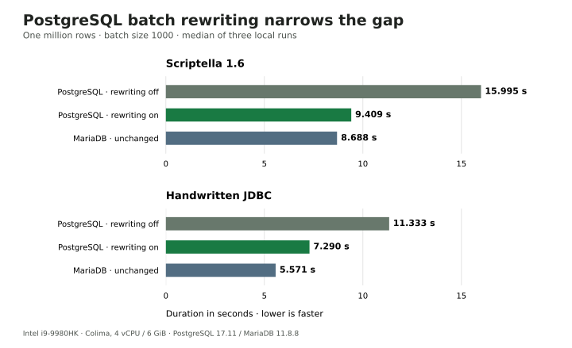

# PostgreSQL JDBC batch rewriting for million-row CSV imports

Enabling pgJDBC's `reWriteBatchedInserts` option reduced the median duration of
the Scriptella import from **15.995 to 9.409 seconds** in this experiment: a
**1.70× speedup**, or 41.2% less elapsed time. Handwritten JDBC improved from
11.333 to 7.290 seconds, a 1.55× speedup.



One million rows, batch size 1000, median of three local runs. Lower is faster.

## Results

| Database | Implementation | Rewrite | Run 1 | Run 2 | Run 3 | Median |
|---|---|---|---:|---:|---:|---:|
| PostgreSQL | Scriptella | off | 17.214 s | 15.298 s | 15.995 s | 15.995 s |
| PostgreSQL | Scriptella | on | 9.409 s | 9.262 s | 9.482 s | 9.409 s |
| PostgreSQL | JDBC | off | 12.845 s | 11.333 s | 10.952 s | 11.333 s |
| PostgreSQL | JDBC | on | 7.290 s | 7.348 s | 7.165 s | 7.290 s |
| MariaDB | Scriptella | driver default | 8.852 s | 8.688 s | 8.602 s | 8.688 s |
| MariaDB | JDBC | driver default | 5.571 s | 5.694 s | 5.526 s | 5.571 s |

For Scriptella, PostgreSQL went from 84.1% slower than the contemporary MariaDB
control to 8.3% slower. The median difference narrowed from 7.307 to 0.722
seconds. MariaDB Connector/J's bulk insert path and pgJDBC's SQL rewriting are
different mechanisms, so this does not isolate an engine-only difference.

## Method

The experiment used published Scriptella 1.6 artifacts, pgJDBC 42.7.13,
PostgreSQL 17.11, MariaDB 11.8.8, MariaDB Connector/J 3.5.7, Java 17.0.17+10,
and the existing benchmark's deterministic million-row fixture.

Scriptella and handwritten JDBC both used batch size 1000. PostgreSQL explicitly
set `reWriteBatchedInserts=false` or `true`; MariaDB retained its driver defaults.
Rounds 1 and 3 used forward order, while round 2 reversed all six cases. Imports
ran sequentially on an Intel i9-9980HK Mac with a Colima x86_64 VM configured
with 4 vCPU and 6 GiB RAM.

Every variant first passed a 2,001-row smoke import. Each measured import followed
an untimed 20,000-row warmup, verification, and table reset. Timing covered a
fresh client process from start through commit and exit. Each recorded import
then passed separate row-count and representative-value checks. Fixture
generation, database startup, warmup, reset, and verification were outside the
timed interval. All 18 measured imports passed.

The fixture, schema, one-transaction boundary, one commit per import, batch size,
and verifier match benchmark v3. The follow-up has its own compatibility ID,
`v3-pg-rewrite-followup-1`, and must not be pooled with v3 or v4 results.

The historical metadata says `phase=preparation-only`; that inherited value is a
labeling error. The successful status and the 18 rows in `measurements.csv`
identify the measured follow-up. The raw evidence remains unchanged.

## Files

- [`results/measurements.csv`](results/measurements.csv): all 18 verified timings.
- [`results/environment.properties`](results/environment.properties): curated
  environment, dependency, fixture, and durability metadata.
- [`analyze.py`](analyze.py): validates the experiment invariants and regenerates
  the result table and comparisons.
- [`figures/rewrite-comparison.svg`](figures/rewrite-comparison.svg): accessible
  article chart generated from the recorded medians.

Run the analysis with Python 3 and no third-party packages:

```sh
python3 analyze.py
```

The complete reusable benchmark, follow-up runner, individual process logs, and
the v4 methodology are maintained in
[`scriptella/scriptella-benchmarks`](https://github.com/scriptella/scriptella-benchmarks/tree/main/docs/results/2026-10-21-pg-rewrite).
The full benchmark repository is the reproduction source; this directory is the
curated article evidence.

## Limits

This is one CSV workload on one machine, with three observations per
configuration. End-to-end time includes startup, CSV parsing, conversion,
database writes, and commit. The table has no generated keys, indexes, triggers,
or transformations. The result supports this compatible batch-insert workload;
it is not a universal PostgreSQL performance claim.
