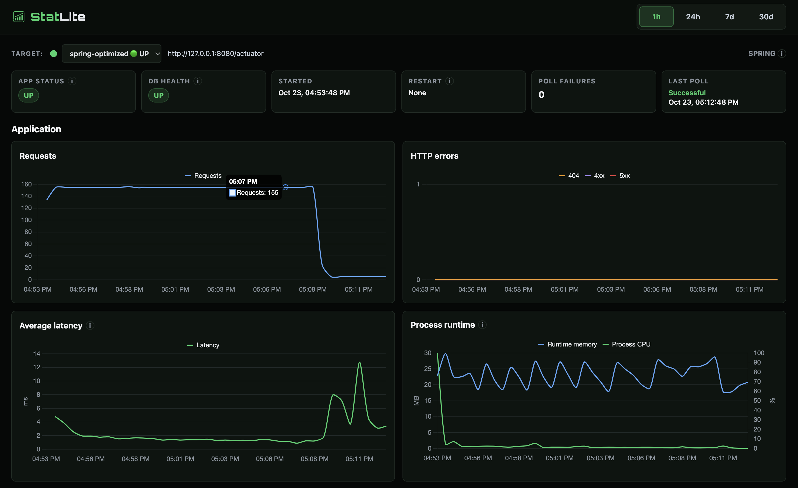

# Optimized Spring Boot observed with StatLite

StatLite observing the optimized Spring Boot deployment. Traffic drops when the
test ends; status cards reflect post-run inspection. Runtime memory is JVM heap
usage, not process RSS.

## Evidence provenance

The original operator-supplied image is unchanged. It shows `spring-optimized`
with a one-hour range. Exact capture time was not supplied; the last-poll card
shows October 23, 2026, 17:12:48 Pacific. The separate recorded 5 rps workload ran
16:53:52–17:08:52 Pacific, completing 4,500 requests without workload errors.
Later activity is monitoring and inspection. The request graph is a count per
polling interval, not rps: approximately 155 per 30 seconds includes offered
load plus collection. Dashboard latency is a server-side aggregate, not the
external workload's end-to-end p50/p95. Two startup health-readiness 503s are
separate from the workload result and are not erased by the flat error chart.
