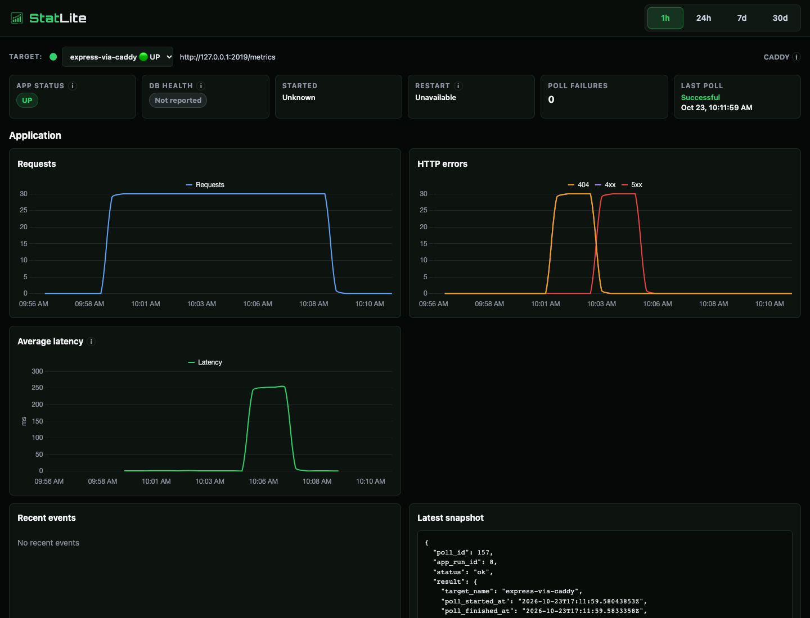
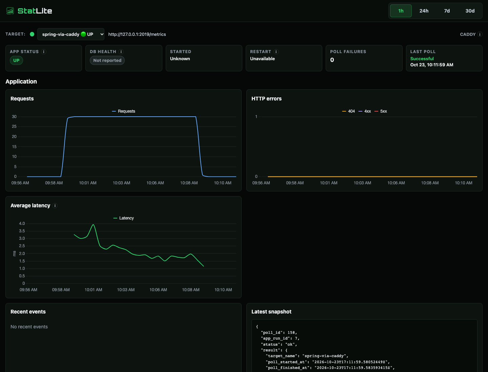
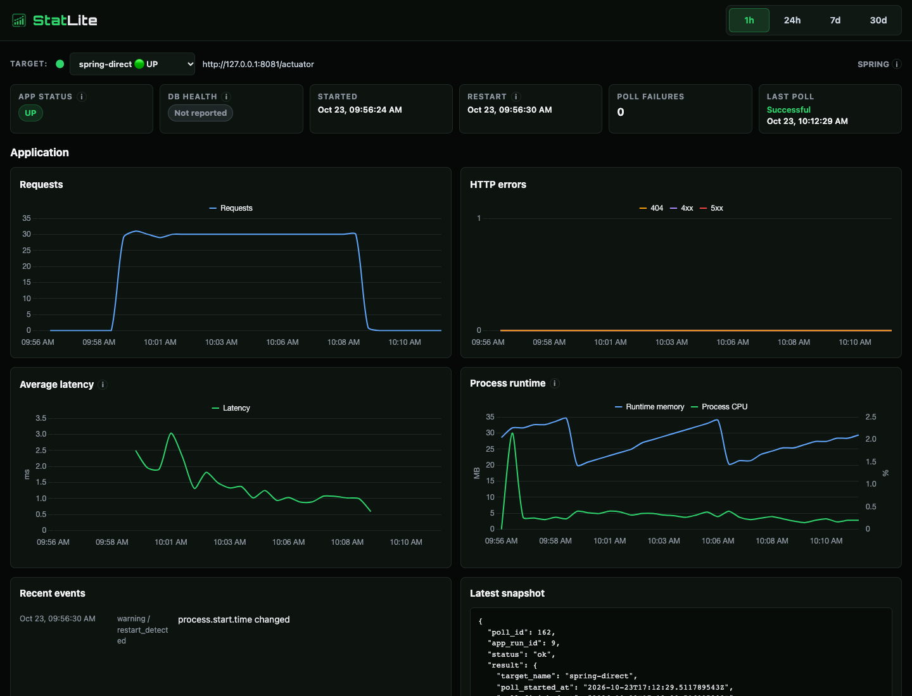

# Monitoring applications through Caddy: experiment report

A reverse proxy already observes traffic for the applications behind it. This
experiment tested whether Caddy's built-in per-host metrics could provide
useful HTTP history in StatLite without adding metrics code to those
applications. The objectives were to make request volume, HTTP errors and
latency changes visible, verify that two hosts retained independent histories,
and show what direct Spring Boot monitoring adds beyond the proxy view.

The experiment succeeded. Express's deliberately introduced 404s, 500s and slow
successful responses appeared in its Caddy target, followed by recovery. Spring
Boot's independent traffic did not acquire those errors or the latency spike.
Its direct target added application health and process runtime information.
This was a controlled monitoring demonstration, not a framework benchmark or an
active availability test.

The complementary [website article](https://pvrlabs.xyz/articles/monitoring-applications-behind-caddy.html)
focuses on configuring HTTP monitoring for applications already behind Caddy.
This report preserves the measured environment, methodology and evidence.

## Setup and monitoring boundaries

One Ubuntu VM ran Caddy, Express, Spring Boot and StatLite as direct guest
processes. Caddy served two named HTTPS hosts, each with one direct reverse
proxy upstream. Express had no metrics instrumentation. Spring Boot included
standard Actuator/Micrometer for the optional direct comparison; Caddy did not
need those endpoints to monitor Spring's HTTP traffic.

| Component | Recorded version or configuration |
| --- | --- |
| Lima | 2.2.0, VZ, x86_64 |
| Guest | Ubuntu 24.04.5 LTS, 2 vCPU, 2 GiB RAM, 12 GiB sparse disk |
| Caddy | 2.11.4 |
| Node / Express | 24.21.0 / 5.1.0 |
| Spring Boot | 4.0.0 |
| Java | Ubuntu OpenJDK 25.0.4.1+1-1-24.04.4-Ubuntu |
| Maven | 3.8.7 |
| StatLite | v0.6.2-dev, revision `a4881332e2f27a84749e568a12bd7103f64dd728` |
| Go / build | 1.27.1, Linux amd64, CGO disabled |
| Polling | 30 seconds |

The reused StatLite binary's SHA-256 was
`5fd90db2bc29092ce7b3755f5086b0f38bfdc612e02e89e324253b04e1597675`.
This identifies the observed artifact, not a reproducible-build guarantee.
The binary and installed dependencies came from an earlier functional smoke
run. SQLite history was retained, so the workload compares before and final
snapshots rather than treating lifetime totals as newly generated traffic.

The release context matters: the recorded artifact was a development build,
not StatLite 0.7.0. Caddy support was added after the released v0.6.1 tag and is
intended for the upcoming 0.7.0 release. The [reproduction guide](reproduction-guide.md)
builds the exact recorded source revision instead of relying on release timing.

## Caddy and the three StatLite targets

The [Caddyfile](Caddyfile) enabled per-host metrics:

```caddyfile
{
    admin 127.0.0.1:2019
    metrics {
        per_host
    }
}

spring.test {
    tls internal
    reverse_proxy 127.0.0.1:8080
}

express.test {
    tls internal
    reverse_proxy 127.0.0.1:3000
}
```

The guest resolved both test hostnames to loopback and trusted Caddy's internal
CA. Workload curl requests verified HTTPS certificates without `-k`. This
exercised local HTTPS, not public DNS, ACME or public certificate issuance.
Caddy bound normal ports 80/443. Application backends, Actuator, Caddy admin
and StatLite bound loopback; only the dashboard was forwarded to the host.

The [complete StatLite configuration](statlite.yaml) defined three targets:

```yaml
server:
  listen: "127.0.0.1:9090"
storage:
  sqlite_path: "./run/statlite.sqlite"
polling:
  interval: "30s"
targets:
  - name: express-via-caddy
    type: caddy
    url: http://127.0.0.1:2019/metrics
    host: express.test
  - name: spring-via-caddy
    type: caddy
    url: http://127.0.0.1:2019/metrics
    host: spring.test
  - name: spring-direct
    type: spring
    url: http://127.0.0.1:8081/actuator
```

Both Caddy targets read the same metrics endpoint but selected different exact
host labels. The direct target read Spring Actuator separately. The application
sources are in [express/](express/) and [spring/](spring/). Both fixtures supply
`/ok`, `/fail` and `/slow`; Express's unmatched `/missing` route supplies the
404 phase without an additional handler.

The authoritative [Caddy monitoring guide](https://github.com/PVRLabs/statlite/blob/main/docs/targets/caddy.md)
and [Spring monitoring guide](https://github.com/PVRLabs/statlite/blob/main/docs/targets/spring.md)
provided the monitoring setup. No collector or public monitoring documentation
changes were necessary for this experiment.

## Controlled workload and collection method

The measured run took place on October 23, 2026, from 16:59 to 17:10 UTC
(09:59 to 10:10 PDT). The [workload script](scripts/article-workload.py) sent
one request per second to each host for five 120-tick phases, using a
monotonic clock for pacing. It logged every response code and client duration
in [traffic.jsonl](evidence/traffic.jsonl). Both hosts received 600 requests,
1,200 requests in total. Spring received `/ok`, 200 throughout.

| Phase | Start UTC | End UTC | Express route and expected response |
| --- | --- | --- | --- |
| Baseline | 16:59:04 | 17:01:03 | `/ok`, ordinary 200 |
| Not found | 17:01:03 | 17:03:03 | `/missing`, 404 |
| Server errors | 17:03:03 | 17:05:02 | `/fail`, deliberate 500 |
| Slow success | 17:05:02 | 17:07:02 | `/slow`, 200 after a deliberate 250 ms delay |
| Recovery | 17:07:02 | 17:09:01 | `/ok`, ordinary 200 |

The [manifest](evidence/manifest.json) preserves exact timestamps. Guest
wall-clock adjustment makes these phases slightly shorter than two wall-clock
minutes; the workload used monotonic timing. These are observed phase times,
not a claim of benchmark-grade timing precision.

The harness captured read-only public status/metrics and dashboard
summary/series/events before traffic, at each phase boundary, and after a
40-second settling wait. It also captured raw Caddy metrics at each boundary.
Final API evidence was captured at 17:09:41 UTC. Collection used ordinary
30-second polls throughout, with no manual polling or accelerated interval.

For new reproductions, [the guide](reproduction-guide.md) starts a fresh
observation database before each measured workload, archiving the previous
SQLite files. This prevents earlier observations from expiring out of the
rolling API window between baseline and final captures. The original run used
retained history as recorded above; its verified observations are unchanged.

The public snapshot retains the complete traffic log, phase manifest, before
and final metric series, and all seven boundary collection-status captures
needed by the [checker](scripts/check-article.py). Full intermediate scrapes,
process logs, certificates and SQLite files are omitted. The three selected
screenshots have separate paired dashboard API snapshots.

### Delta and latency interpretation

Reported counts subtract the before snapshot from the final retained history.
The dashboard retains individual poll intervals; the public metrics API groups
whole poll deltas into the UTC minute containing the ending poll. A minute at
a phase boundary can therefore contain traffic from two phases. Counter totals
are operational observations, not accounting-grade guarantees under arbitrary
resets or collection gaps.

The results table below uses interior public API minute buckets at 17:06 UTC
and 17:08 UTC for slow-phase and recovery latency. These avoid mixed phase
boundaries. The published checker independently verifies latency using complete
poll intervals contained inside each phase, avoiding dependence on how a
future rerun aligns with minute boundaries. Its per-poll values in
[assertions.json](evidence/assertions.json) consequently differ from the table's
minute averages. Both are derived from the same recorded observations.

## Requests, errors and latency

| Target | Requests | 404 / 4xx | 5xx | Slow-phase average latency | Recovery average latency |
| --- | ---: | ---: | ---: | ---: | ---: |
| Express via Caddy | 600 | 120 / 120 | 120 | 251.909 ms | 1.084 ms |
| Spring via Caddy | 600 | 0 / 0 | 0 | 1.671 ms | 1.850 ms |
| Spring direct | 600 | 0 / 0 | 0 | 0.959 ms | 1.040 ms |

All seven captures for all three targets reported successful collection, zero
consecutive collection failures and a fresh successful poll. Dashboard series
verify the 404 counts separately because the public metrics API exposes
combined 4xx counts. Every Express 4xx in this workload was a 404: the 404 and
4xx lines count the same responses and must not be added together.

### Express through Caddy



*StatLite monitoring an Express application through Caddy. The controlled
workload introduces HTTP errors and slower responses, all visible without
application instrumentation.*

The error bursts are distinct from the subsequent slow-success phase. The
250 ms delay raised latency without requiring HTTP errors, and ordinary
responses afterward returned latency to its earlier level while traffic
continued. The request chart shows counts per polling interval, around 30,
not requests per second. Its last drop to zero marks the generator stopping,
not an application outage.

### Per-host isolation



*Spring Boot received the same steady traffic through the same Caddy instance,
with a separate host selection and independent HTTP history.*

Spring's Caddy target retained 600 requests, no 4xx or 5xx, and low latency
throughout Express's injected failures and delay. The direct Spring target
independently corroborated successful Spring traffic. This supports per-host
attribution for the tested routing shape, not arbitrary isolation across
catch-all sites or applications sharing one host label.

### What direct Spring Boot monitoring adds



*Direct Spring Boot monitoring adds application and runtime context that the
Caddy targets do not report.*

Spring Actuator supplied application health UP, startup time, JVM heap memory
and process CPU. Caddy targets had no application runtime measurements or
upstream application health signal. No database was configured, so database
health was not expected. The Spring screenshot's restart event at 16:56 UTC
came from starting the fixture with retained history, before the workload;
no restart was injected during measurement.

The proxy and direct integrations observe different boundaries. Their latency
values are not interchangeable, and these measurements do not compare the
performance of Express and Spring Boot.

### Screenshot provenance

The unmodified 1440 by 1100 dashboard viewports were captured around 17:12 UTC,
after the workload, using retained history. The displayed timezone is PDT.
Chart animation was completed before capture; metric values and chart data
were not edited. Each image has an adjacent API snapshot with series, summary,
URL and capture time:

- [Express API snapshot](screenshots/express-recovery-api.json).
- [Spring via Caddy API snapshot](screenshots/spring-caddy-api.json).
- [Spring direct API snapshot](screenshots/spring-direct-api.json).

The API fetch follows each screenshot by a few seconds. They are paired
observations, not atomic captures. See [screenshot notes](screenshots/README.md).

## Limits and execution notes

- Caddy's **UP** means StatLite can collect Caddy metrics. It does not verify
  upstream health; Caddy-generated failures can coexist with successful collection.
- Only HTTP traffic passing through the selected proxy host is represented.
  Background jobs, bypass traffic and failures inside HTTP 200 payloads are
  outside this view. StatLite does not inspect response bodies.
- Proxy response latency includes work observed at Caddy. It does not isolate
  application execution time; averages hide tail latency and route mixes.
- This run exercised Caddy 2.11.4 with explicit named HTTPS sites and one direct
  reverse proxy per host. It does not establish compatibility with every Caddy
  version, wildcard/catch-all sites, path-separated apps or mixed static/API routing.
- Local certificate-verified HTTPS was exercised; public certificate issuance
  and production deployment behavior were not tested.
- Dependencies and the recorded artifact are versioned observations. The Ubuntu
  image and package patches float, so the fixture is not an immutable image.

An initial capture attempt failed before traffic because the public API
rejects an unsupported `range` parameter. The corrected harness started a
separate run and uses `range` only for dashboard endpoints. No measured phase
required a retry. Services and the VM were stopped after evidence capture.
No new measurement was run while preparing this report.

## Reproduce or inspect the evidence

The [reproduction guide](reproduction-guide.md) covers prerequisites, the pinned
StatLite source build, application setup, workload, optional screenshots and
shutdown. The fixture scripts are:

- [setup.sh](scripts/setup.sh), [start.sh](scripts/start.sh) and [stop.sh](scripts/stop.sh).
- [smoke.sh](scripts/smoke.sh) and [check-smoke.py](scripts/check-smoke.py) for functional checks.
- [article-workload.py](scripts/article-workload.py) for controlled traffic and capture.
- [check-article.py](scripts/check-article.py) for evidence verification.
- [capture-dashboard.sh](scripts/capture-dashboard.sh) for dashboard images and paired APIs.

To verify the published evidence without running any services, from this directory:

```sh
python3 scripts/check-article.py evidence
```

The [evidence directory](evidence/) contains the checker's complete inputs,
including [final public metrics for Express](evidence/final-express-via-caddy-v1-metrics.json),
[Spring via Caddy](evidence/final-spring-via-caddy-v1-metrics.json) and
[Spring direct](evidence/final-spring-direct-v1-metrics.json), plus corresponding
before snapshots and dashboard series. The checker verifies traffic counts and
expected codes, collection freshness, error attribution, latency rise/recovery,
and runtime visibility using only those recorded files.
